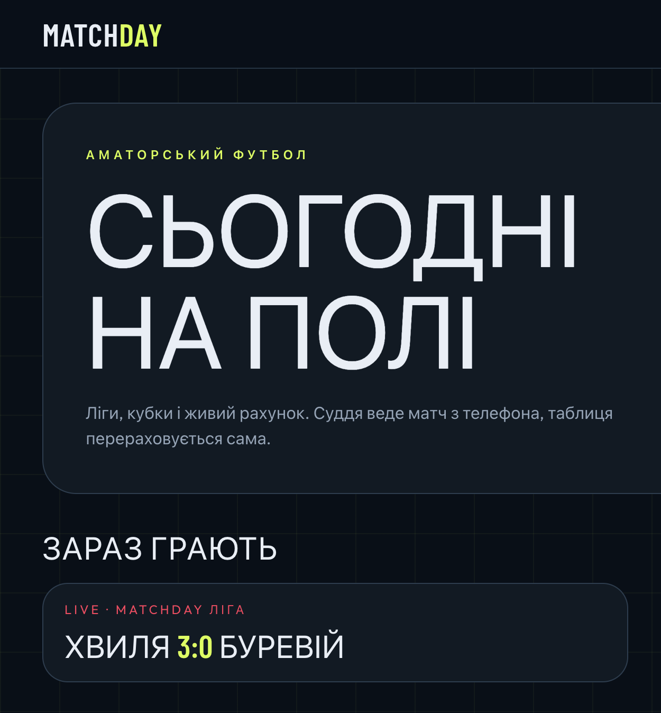
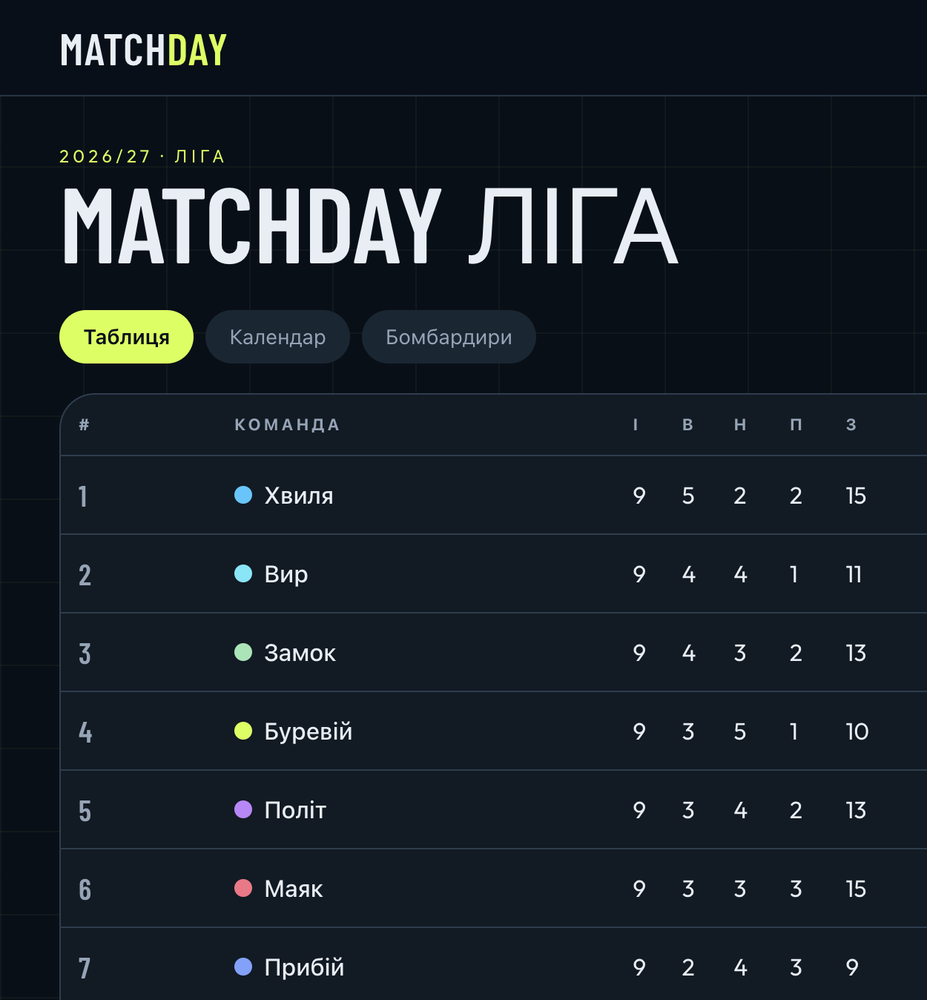
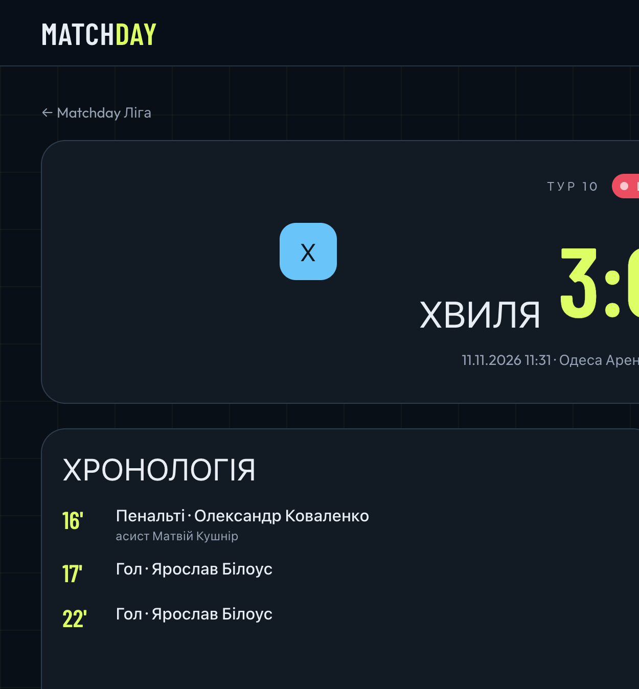

# Matchday

A platform for amateur football leagues and tournaments: fixtures, standings, a live score, and season statistics.

An organizer builds a tournament and generates the calendar. A captain manages their own squad. A referee adds goals, cards, and substitutions from a phone, and the public match page updates the score over WebSocket. After the final whistle the table is recalculated on the queue.







## Stack

The app runs on **Laravel 12** and PHP 8.3. Laravel 11 was blocked by Composer at the time of creation because of unfixed security advisories (the patches exist only in 12.x), so the skeleton is Laravel 12 with the same packages: Inertia.js, Vue 3, Tailwind CSS, Laravel Breeze, Sanctum, Reverb, Echo, Pest, and Sail (MySQL 8.4 + Redis).

The match model is named `Game` and stored in the `matches` table: `match` is a reserved word in PHP 8.

## Running with Sail

Docker and Composer are required.

```bash
cp .env.example .env
composer install
php artisan key:generate
./vendor/bin/sail up -d
./vendor/bin/sail artisan migrate --seed
./vendor/bin/sail artisan storage:link
./vendor/bin/sail artisan reverb:start
./vendor/bin/sail artisan queue:work
./vendor/bin/sail npm install
./vendor/bin/sail npm run dev
```

The site is at [http://localhost](http://localhost). Reverb listens on port `8080`. Redis holds the cache, sessions, and queues. `MatchFinished` queues a standings refresh, so `queue:work` needs to run alongside the site.

Tests do not need Docker. They run on SQLite in memory.

```bash
php artisan test
```

## Demo login

The password for every account is `password`.

| Role | Email |
| --- | --- |
| Administrator | `admin@matchday.test` |
| Referee | `referee@matchday.test` |
| Second referee | `referee2@matchday.test` |
| Captain of Bureviy | `captain@matchday.test` |
| Captains of the other clubs | `captain2@matchday.test` … `captain10@matchday.test` |

The seeder creates the Matchday League for the 2026/27 season: 10 teams of 15 players, a double round-robin, rounds 1–9 already played, and one live match in round 10.

## API

Public `GET` endpoints do not need a token. The prefix is `/api`. A tournament is addressed by its slug.

Request a token:

```bash
curl -X POST http://localhost/api/login \
  -H 'Accept: application/json' \
  -d 'email=admin@matchday.test' \
  -d 'password=password' \
  -d 'device_name=laptop'
```

The response is `{ "token": "...", "user": { "id", "name", "email", "role" } }`. Invalid credentials return `422`.

Send `Authorization: Bearer {token}` after that.

| Method | Path | Access | Returns |
| --- | --- | --- | --- |
| `POST` | `/api/login` | guest | a Sanctum token and the user |
| `POST` | `/api/logout` | token | revokes the current token |
| `GET` | `/api/user` | token | the current user |
| `GET` | `/api/tournaments/{slug}/standings` | public | tables: played, won, drawn, lost, goals, difference, points, form |
| `GET` | `/api/tournaments/{slug}/fixtures?round=` | public | matches; `round` is optional |
| `GET` | `/api/tournaments/{slug}/top-scorers` | public | goals, penalties, assists |
| `GET` | `/api/matches/{id}` | public | score, timeline, lineups |

Example:

```bash
curl http://localhost/api/tournaments/matchday-liga/standings
curl http://localhost/api/tournaments/matchday-liga/fixtures?round=10
curl http://localhost/api/matches/1
```
